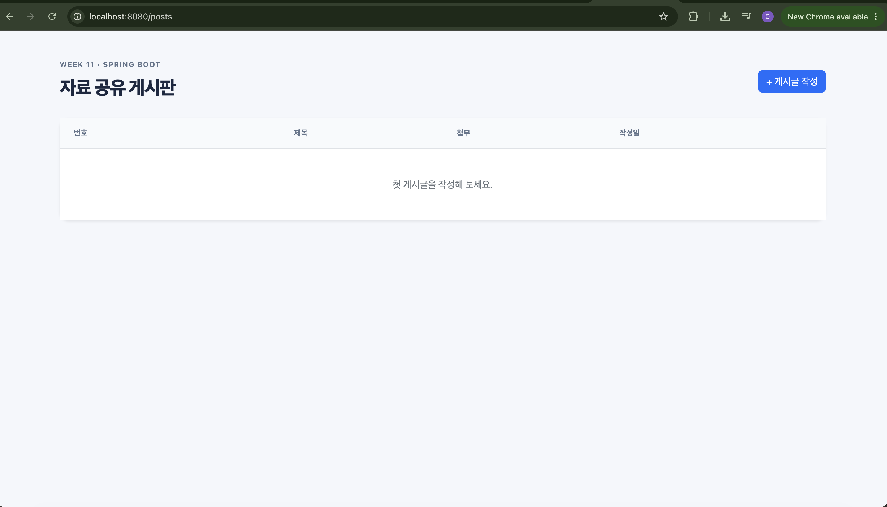
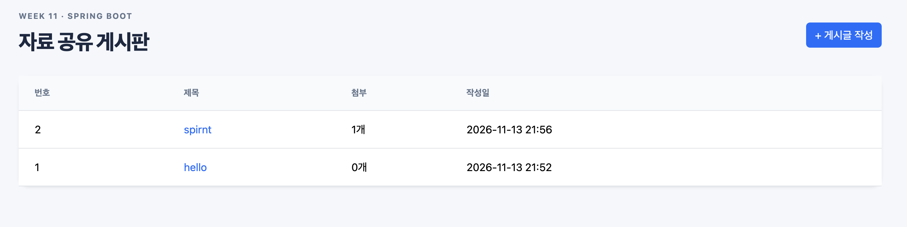
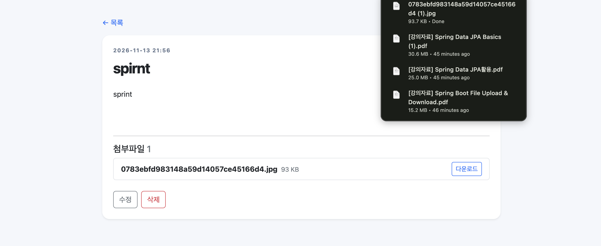

# Week 11 — Attachment Board (Student Sample)

Spring Boot + Thymeleaf + JPA + MariaDB: 게시글 CRUD / 다중 첨부파일 업로드 / 다운로드

## 실행하기
1. Java 17+ 및 MariaDB 준비, `CREATE DATABASE web11 CHARACTER SET utf8mb4;`
2. 환경변수 `DB_URL`, `DB_USERNAME`, `DB_PASSWORD`를 자신의 MariaDB에 맞게 설정. 기본값은 `jdbc:mariadb://localhost:3306/web11`, `webuser`, `webpass`.
3. Gradle이 설치된 환경: `gradle bootRun` / IntelliJ: `AttachmentBoardApplication.main()` 실행.
4. 접속: http://localhost:8080/posts

> Gradle Wrapper는 이 ZIP에 포함되어 있지 않습니다. IntelliJ의 Gradle 지원 또는 설치된 Gradle을 사용하세요. `gradle wrapper` 실행 후 생성된 wrapper 파일은 Git에 포함하는 것을 권장합니다.

## 구현된 기능
- 게시글 목록 / 생성 / 상세 / 수정 / 삭제
- 게시글 생성 시 여러 파일 선택, UUID 이름으로 `uploads/`에 저장
- `attachments` 테이블에 메타데이터 저장
- 첨부파일 다운로드 (`GET /attachments/{id}/download`)

## 학생 과제 (TODO)
1. 코드를 분석하여 업로드/다운로드 요청 흐름 정리
2. 화면이나 정보 표시 3곳 이상 수정
3. **이미지 미리보기** 구현: `GET /attachments/{id}/view` + 상세 화면 `` 표시. 이미지(jpg/jpeg/png/gif)만 허용하고 `Content-Type` 정확히 설정
4. 정상/오류 테스트 후 README 및 Weekly Review 작성

## 코드 위치
- `PostController`: 게시글 화면 / Form
- `AttachmentController`: 다운로드 + 미리보기 TODO
- `PostService`: JPA CRUD와 파일 저장 연결
- `FileStorageService`: 파일 검증 / UUID 저장 / 로드
- `Post`, `Attachment`: 1:N 관계
- `templates/posts/detail.html`: 미리보기 TODO

## 주의사항
- 학습용 프로젝트입니다. 로그인/접근 권한, 업로드 파일의 실제 바이트 검증, 악성 파일 검사, CSRF 보호, 파일 저장과 DB 트랜잭션의 완전한 일관성 보장 등은 구현하지 않았습니다. 인터넷 공개 배포 전에 보강이 필요합니다.
- `spring.jpa.hibernate.ddl-auto=update`는 학습용 설정이며 운영 DB에는 그대로 사용하지 않습니다.
- Render 기본 파일 시스템에 저장된 업로드 파일은 재시작/재배포 시 유지되지 않을 수 있습니다. 이번 과제는 **로컬 파일 처리**를 평가합니다.

학번: 22400132  
이름: 김예준

Project Information
프로젝트 주제 및 주요 기능 - 파일을 첨부할 수 있는 게시판이다. 제공된 Sample Project를 실행하고 게시글 등록, 조회, 수정, 삭제와 파일 업로드, 다운로드를 확인했다. 상세 화면의 문구와 버튼 색상을 바꾸고 파일 타입을 추가했다. 첨부한 이미지를 상세 화면에서 바로 볼 수 있는 미리보기 기능도 구현했다.
GitHub Repository URL - https://github.com/yejunkim0429/11week_assignment
Render Deployment URL - 

Installation
사용 환경 - Spring Boot, Thymeleaf, JPA, MariaDB를 사용했다.

1. 프로젝트를 clone하고 intellij에서 열었다.
2. dbeaver에서 mariadb 연결이 되는지 먼저 확인했다.
3. intellij의 run → edit configurations → environment variables에 DB_URL, DB_USERNAME, DB_PASSWORD를 등록했다.
4. AttachmentBoardApplication.main()을 실행했다.
5. http://localhost:8080/posts 에 접속했다.
db 비밀번호와 실제 업로드 파일은 GitHub에 포함하지 않았다.

Source Code Exploration
Project Structure & Spring MVC
1. PostController, PostService, PostRepository는 각각 어떤 역할을 하며, 서로 어떻게 연결되는가?
   -> postcontroller는 웹 요청하고 응답을 처리한다. crud의 기능을 받아서 postservice를 호출하고 화면 기능을 반환한다.
   -> postservice는 게시글을 처리하는 로직을 수행한다. 게시글을 생성하고 첨부파일을 저장하는 요청을 하고 db 저장 등을 관리한다.
   -> postrepository는 db에 접근하는 것을 담당한다. JpaRepository<Post, Long>를 상속해서 post의 crud기능을 제공한다.

2. 게시글 작성 시 HTML Form의 입력값과 첨부파일은 Controller에 어떻게 전달되는가?
   -> postform에 제목과 내용을 담는다. 그리고 @Valid는 postform에서 선언한 빈 값과 길이 제한을 검사하고 결과를 BindingResult errors로 확인한다.
   -> List<MultipartFile> files로 첨부파일을 담는다. 이름이 files 파일 입력으로 첨부 된 파일들을 받는다. 여러개의 파일도 받을 수 있다.
   -> 이후에 오류가 없다면 service로 전달한다. 즉, 작성 폼으로 보낸 한 요청을 controller가 글 정보랑 파일 정보로 나눠서 받는다.

JPA & Entity Relationship
1. Post와 Attachment Entity는 어떤 관계이며, @ManyToOne과 @OneToMany는 각각 어떤 역할을 하는가?
   -> post는 게시글의 정보를 담는 객체이며 attachment는 첨부파일 정보를 담는 객체다. post랑 attachment는 1:n의 관계다.
   -> @ManyToOne은 첨부파일의 입장에서 각각 게시글 하나에 속해있다는 의미이고 @OneToMany는 게시글 입장에서 게시글 하나에 첨부파일이 여러개 있다는 의미이다.

2. cascade = CascadeType.ALL과 orphanRemoval = true는 어떤 역할을 하며, 실제 디스크에 저장된 파일에도 영향을 주는가?
   -> cascade = CascadeType.ALL 게시글의 저장 작세 등의 jpa 작업을 attachment entity에도 전달한다.
   -> orphanRemoval = true는 게시글의 첨부파일 목록에서 어떤 첨부파일을 없애면 연결이 끊어진 attachment의 db 정보도 같이 삭제한다.
   -> 실제 디스크에 저장된 파일에는 영향을 주지 않는다. jpa는 db의 엔티티 정보를 관리학기 때문이다.

File Upload
1. MultipartFile은 무엇이며, 업로드된 파일은 어떤 과정을 거쳐 서버에 저장되는가?
   -> MultipartFile은 브라우저가 보낸 업로드 파일을 spring에서 다루는 인터페이스다. 파일의 내용, 원본 이름, 크기 등 확인 가능하다. 그러나 받았다고 해서 서버에 영구 저장되는 것은 아니다.
   -> PostController.java → create()
   @RequestParam("files")로 파일들을 List<MultipartFile>에 받고 PostService.create()에 전달한다.
   -> PostService.java → create()
   비어 있지 않은 파일마다 storage.store(file)을 호출
2. 파일을 원본 이름 대신 UUID 기반 파일명으로 저장하는 이유는 무엇인가?
   -> 이름이 같은 파일들이 서로 덮어쓰기 하는 것을 방지하기 위해서다.
   -> FileStorageService.java의 store()에서 UUID.randomUUID()에 확장자를 붙여 저장이름을 만든다.
   -> 원본 이름은 Attachment.originalFilename에 별도로 보관한다.

File Download & Security
1. 파일 다운로드 시 Resource, ResponseEntity, Content-Disposition은 각각 어떤 역할을 하는가?
   -> Resource는 보낼 파일에 접근하는 역할을 한다. FileStorageService.load()가 실제 저장 경로인 PathResource를 반환하고 Spring은 파일 내용을 읽어서 브라우저도 반환한다.
   -> ResponseEntity는 http 응답 전체를 구성하는 역할을 한다. AttachmentController.download()에서는 상태 코드 200 OK랑 파일 타입과 다운로드 관련 헤더 본문의 Resource를 묶어서 반환한다.
   -> Content-Disposition는 브라우저에 다운로드 방식과 파일명을 알려주는 역할을 한다. ContentDisposition.attachment()는 다운로드용인것을 알려주고 .filename(...)은 원본 파일명으로 저장할 수 있도록 한다.
2. 파일 저장 과정에서 normalize()와 startsWith()를 사용하는 이유는 무엇인가?
   -> 파일이 지정된 업로드 폴더 밖에 저장되지 않도록 하기 위해서다.
   -> normalize()는 경로에 들어있는 . 이나 .. 같은 상대 경로 요소를 정리한다. /app/uploads/../secret.txt -> /app/secret.txt
   -> startsWith()는 저장 폴더 내부인지 검사하기 위해 사용한다.

Customizing
수정 파일 - `src/main/resources/templates/posts/detail.html`

1. Text
변경 전 - 첨부파일 영역 제목이 "첨부파일" 이었다.
변경 후 - 제목을 "첨부합니다" 로 바꿨다.

2. Style
변경 전 - 다운로드 버튼이 파란색 테두리 버튼이었다.
변경 후 - "btn-outline-primary" 를 "btn-success" 로 바꿔 초록색 배경의 버튼으로 표시했다.

3. UI/Data
변경 전 - 첨부파일의 이름과 크기만 표시했다.
변경 후 - 파일 타입도 추가했다. 이미지 파일은 "image/jpeg" 처럼 표시되어 파일 종류를 확인할 수 있게 했다.

New Feature
추가한 기능 - 이미지 미리보기
수정 파일 및 메서드
- "AttachmentController.java" 의 "view()"
- "templates/posts/detail.html"
"GET /attachments/{id}/view" 요청을 처리하는 메서드를 추가했다. 첨부파일 정보를 조회하고 이미지 타입인지 검사한 뒤 "FileStorageService.load()" 로 실제 파일을 가져온다. 이미지에 맞는 "content-type" 과 화면 표시용 "content-disposition: inline"을 설정했다.
상세 화면에서는 Thymeleaf의 를 사용했다. jpg, png 등등 에 해당하는 이미지 타입만 표시하도록 했다. pdf 같은 파일은 기존 다운로드 버튼으로 받을 수 있게 했다.
없는 첨부파일의 id를 요청하면 404 오류가 나오도록 했다. db에 파일 정보가 있어도 실제 파일이 없으면 404 오류가 나오는 것도 확인했다.

Testing & Deployment

- 게시글 등록, 조회, 수정, 삭제를 확인했다.
- 이미지 업로드와 다운로드를 확인했다.
- PDF를 첨부하고 다운로드되는지 확인했다.
- 게시글 상세 화면에서 이미지가 바로 표시되는 것을 확인했다.
- DB에 없는 첨부파일 ID를 요청해서 404와 "첨부파일이 없습니다" 메시지를 확인했다.
- 실제 저장 파일의 이름을 임시로 바꿔서 404와 "파일이 없습니다"  메시지를 확인했다.
- 테스트 후 파일 이름을 복원했다.

초기 실행 화면

파일 업로드 성공 화면

파일 다운로드 성공 화면

이미지 미리보기 실행 화면

Weekly Review
1. "multipartfile" 로 파일을 받는 것과 서버 디스크에 실제로 저장하는 것은 다른 과정이라는 것을 배웠다.
2. 실제 파일은 디스크에 저장하고 파일 이름, 크기, 타입 같은 정보는 db에 따로 저장한다는 것을 배웠다.
3. 다운로드와 이미지 미리보기는 응답 설정이 다르다는 것을 배웠다.

어려웠던 점과 해결 방법
처음 실행할 때 db 연결 오류가 났다. dbeaver에서는 연결됐는데 프로젝트 설정은 localhost로 되어 있었다. intellij 환경변수에 db 주소와 계정 정보를 등록해서 실행했다.
파일 업로드를 할 때 413 오류도 났다. 파일 크기 제한을 확인하고 작은 이미지로 다시 업로드해서 성공했다.
오류 테스트 주소에 "없는번호" 라는 글자를 그대로 넣기도 했다. 실제로 db에 없는 숫자 id를 넣어서 다시 확인했다.

AI 활용 내용 및 느낀 점
Codex를 사용했다. Controller, Service, Repository의 역할과 JPA 관계, 파일 업로드와 다운로드 과정을 질문했다. 코드 설명 주석과 이미지 미리보기 구현 예시, 화면 수정, 오류 원인과 Git 사용 방법도 도움을 받았다.
제공받은 코드를 함께 이해하면서 질문했다. 브라우저에서 업로드, 다운로드, 미리보기를 확인했고 dbeaver에서 파일 정보가 저장된 것도 확인했다.
처음에는 코드에 나오는 단어도 잘 몰라서 계속 질문했다. 설명을 들어도 이해가 안 되는 부분은 더 쉬운 말로 다시 물어봤다. 아직 혼자 설명하기 어려운 부분이 있어서 코드를 다시 보면서 이해해야 할 것 같다.